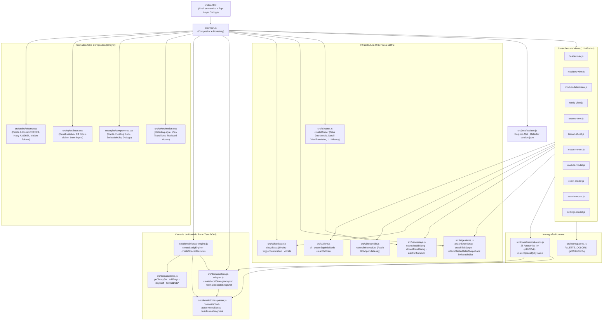
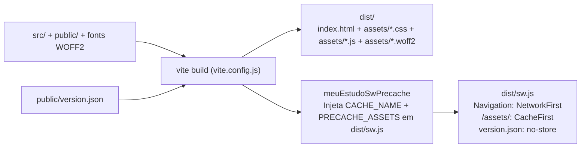

# ARCHITECTURE_MAP · Meu Estudo (v3.0.0)

Mapa estrutural determinístico da arquitetura modular ES + Vite, dependências entre camadas, contratos de persistência (`localStorage`) e pipeline PWA offline-first.

---

## 1. Grafo de Dependências entre Módulos

---

## 2. Responsabilidade por Arquivo

| Camada | Arquivo | Exportações / Responsabilidade Principal |
| :--- | :--- | :--- |
| Entry | [`index.html`](index.html) | Shell semântico com 4 painéis principais, Floating Dock, Bottom Sheet `#sheet-lesson` e 5 `<dialog closedby="any">` |
| Entry | [`src/main.js`](src/main.js) | Carrega fontes `@fontsource` locais + camadas CSS, instancia `StorageAdapter`, `StudyEngine`, `Router`, Views e `PwaUpdater` |
| Domain | [`src/domain/dates.js`](src/domain/dates.js) | Aritmética determinística `YYYY-MM-DD`, diferença em dias (`daysDiff`) e formatação pt-BR sem risco de timezone |
| Domain | [`src/domain/notes-parser.js`](src/domain/notes-parser.js) | Tokenizador puro de `**negrito**`, listas `• ` e marcadores clínicos `[Alerta:]`, `[Padrão-Ouro:]`, `[Fisiopato:]`, `[Diagnóstico:]`, `[Conduta:]`, `[Conceito:]` via nós DOM seguros (zero `innerHTML`) |
| Domain | [`src/domain/storage-adapter.js`](src/domain/storage-adapter.js) | Persistência em `meu_estudo_data_v1` / `meu_estudo_view_mode_v2`, validação de backup JSON, normalização de provas multi-módulo (`moduleIds`) e migração automática de chaves legadas (`joint->reuma`, `general->stethoscope`, `brain+psiquiatria->psiq`) |
| Domain | [`src/domain/study-engine.js`](src/domain/study-engine.js) | Estado reativo (`subscribe`/`emit`), CRUD de módulos/aulas/provas multi-módulo (`getExamModuleIds`), ciclos `D+1`/`D+7`/`D+30`, callbacks `undo()` de 1 toque e busca global |
| Icons | [`src/icons/palette.js`](src/icons/palette.js) | 8 tons editoriais de alto contraste sobre `#FFFFFF` e `#F7F6F3` |
| Icons | [`src/icons/medical-icons.js`](src/icons/medical-icons.js) | 26 anatomias SVG 32×32 (`#162654` ink + preenchimento pastel `currentColor`), `UI_ICONS`, `APP_CREST_SVG` e `matchSpecialtyByName` |
| UI | [`src/ui/dom.js`](src/ui/dom.js) | Construtores DOM seguros (`el`, `clearChildren`, `createSquircleNode`) |
| UI | [`src/ui/reconcile.js`](src/ui/reconcile.js) | `reconcileKeyedList`: atualização cirúrgica por `data-key` sem reconstruir nós não modificados |
| UI | [`src/ui/overlays.js`](src/ui/overlays.js) | Integração top-layer com feature detection `canTransitionDisplay()` (`@starting-style` vs `[data-closing]`), `wireDialogBackdropDismiss` e `askConfirmation` |
| UI | [`src/ui/gestures.js`](src/ui/gestures.js) | Arrasto interruptível WAAPI + `setPointerCapture` (`attachSheetDrag`), swipe horizontal entre abas (`attachTabSwipe`), swipe-back na borda esquerda (`attachMasterDetailSwipeBack`) e `createSwipeListController` (CSS Scroll Snap + `IntersectionObserver`) |
| UI | [`src/ui/router.js`](src/ui/router.js) | Roteamento de abas com transições direcionais (`next`/`prev`), `startViewTransition` (`forward`/`backward`), pilha 1-para-1 `meuEstudoView` e sincronização de `close` nativo em `closedby="any"` |
| PWA | [`src/pwa/updater.js`](src/pwa/updater.js) | Registro de `./sw.js`, polling `./version.json` no boot/`visibilitychange`, descarte por sessão (`sessionStorage`) e limpeza de cache HTTP |

---

## 3. Fluxo de Dados, Histórico & Reconciliação DOM

1. **Bootstrap & Migração:**
   - `createLocalStorageAdapter.loadData()` lê `meu_estudo_data_v1`, normaliza entidades via `normalizeStateSnapshot` e, se houver chaves legadas (`joint`, `general`, `brain` em psiquiatria), persiste a migração de volta imediatamente.
2. **Mutação Reativa:**
   - Ações de view invocam métodos de `engine` -> `persist()` grava no `StorageAdapter` e notifica inscritos (`subscribe`) -> `renderAll()` + `headerNav.sync()`.
   - Listas longas (`modules-view`, `module-detail-view`) usam `reconcileKeyedList`, preservando nós `.is-removing` e foco ativo.
3. **Acessibilidade Sem Aninhamento Interativo:**
   - Cards de módulos (`.module-card`), aulas no detalhe (`.lesson-card`) e itens deslizáveis (`.SwipeableList-content`) utilizam `<button type="button" class="card-open-trigger">` com overlay CSS (`::after`) cobrindo o card, mantendo botões de ação secundários (`.icon-btn-sm`, `.lesson-card-actions`, `.SwipeableList-action`) em `z-index: 2` como irmãos independentes.
4. **Pilha de Histórico (Botão Voltar Android):**
   - Estados válidos empilhados em `history.pushState({ meuEstudoView })`: `'detail'` (ao entrar em um módulo) e `'overlay'` (ao abrir sheet/dialog).
   - Fechamentos por botão, *light-dismiss* (`closedby="any"`), Esc ou arrasto consomem no máximo 1 entrada via `dialogNeedsHistoryConsume` (`WeakSet`), evitando *double-back* quando o evento assíncrono `close` do `<dialog>` dispara após `await closeModalDialog`.

---

## 4. Pipeline de Build & Cache Offline (Vite + Service Worker)

